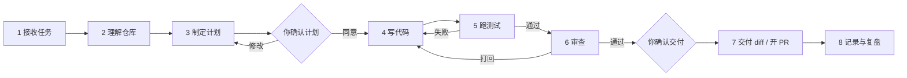
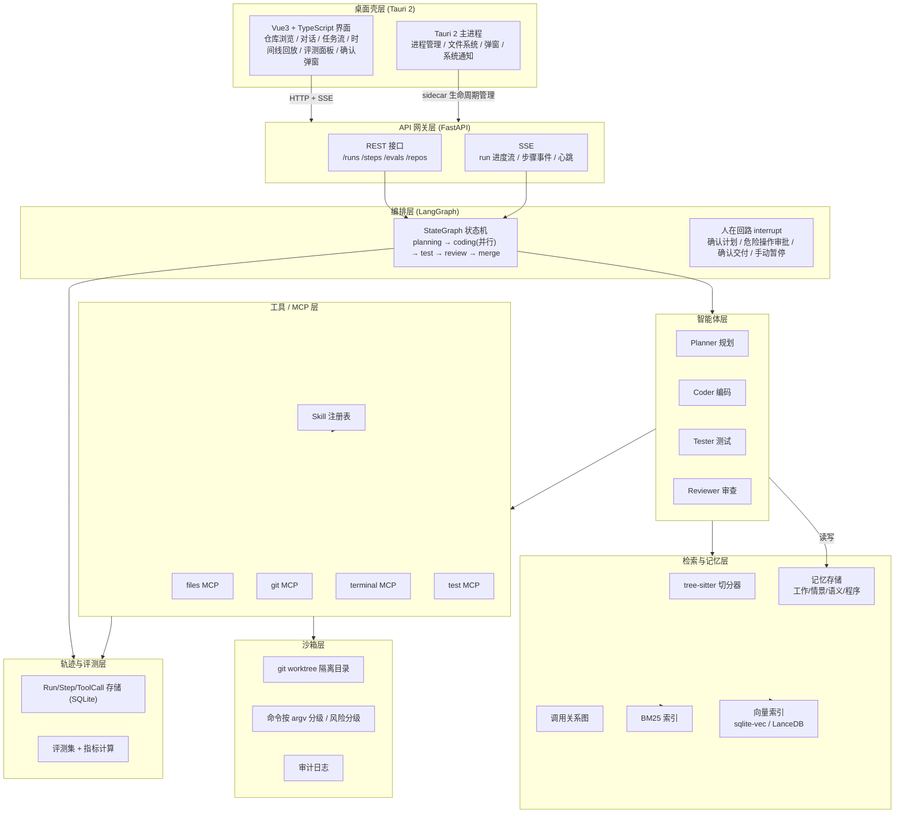
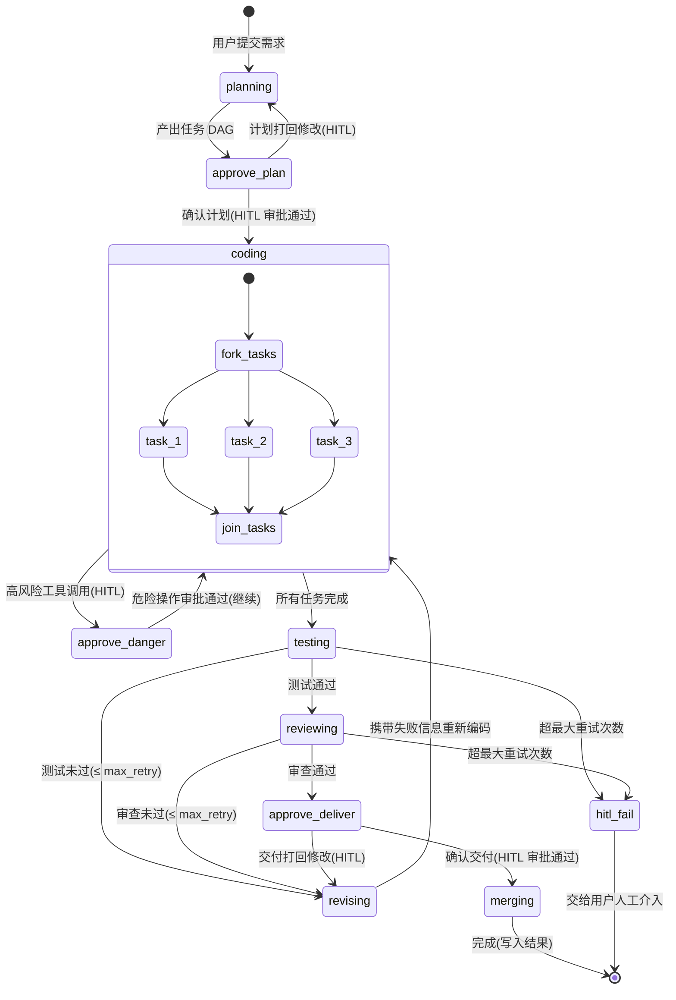

# DevSquad 技术方案

> 桌面端多智能体编程工作台 · 简历旗舰项目技术方案
> 面向岗位：字节 / 腾讯 · Agent 开发、AI 应用开发
> 技术栈：Tauri 2 + Vue3 + TypeScript（桌面壳）｜ Python FastAPI（智能体后端 sidecar）｜ LangGraph（编排）｜ tree-sitter（代码切分）｜ SQLite + 向量库（检索/记忆）｜ MCP（工具）｜ 兼容 OpenAI 协议（模型层）

---

## 第二版修订记录

本版相对初稿（`DevSquad-技术方案-v1.md`）的主要改动：

1. **范围与工期重排**（第 12 节）：第一期大幅缩小范围——向量库、调用图、MCP 化、Tauri 打包、并行 DAG 全部后移；评测前移为 8~10 条迷你评测。第二期加入 Tauri 2 桌面外壳 + sidecar + 打包出可安装桌面应用（硬要求），并承接第一期移出的多智能体、MCP 化、向量检索、并行 DAG。第一期工期调整为约 60~80 小时。
2. **沙箱安全模型重写**（第 6 节）：命令改为按参数列表（argv）执行、不经过 shell；删去「白名单就安全」的表述，明确 `python`/`npm`/`make`/`pytest`(conftest.py) 本质能执行任意代码、worktree 不是安全边界；路径 `realpath` 后必须落在 worktree 内且禁止写 `.git`；子进程不带密钥、默认禁止联网；本地 FastAPI 校验 token、Origin、Host。
3. **密钥与提示注入**（第 6 节）：默认不读 `.env` 与私钥，发给模型前脱敏，工具返回内容只当数据不当指令。
4. **评测防作弊**（第 9 节）：判分改用评测集自带的原版（隐藏）测试，智能体不能改/删测试；每个配置至少跑 3 次并做配对对比；设成本上限。
5. **LangGraph 实现修正**（第 3 节）：并行分支写同一字段声明 reducer；`interrupt` 恢复会重跑整个节点，审批拆成单独节点；崩溃恢复用持久化到 SQLite 的 checkpointer；各角色不再共用一个 `messages`，改为各自最小上下文。
6. **措辞与残留旧说法同步**：MCP 标准传输改为 stdio 与 Streamable HTTP（旧 HTTP+SSE 已替代）；`/hctl` 改为 `/hitl`；第 10 节 `/api/memory` 与第 11 节目录注释同步为四类记忆 / Agent Skills（SKILL.md 文件夹）格式。
7. **其它**：明确第一版目标操作系统；worktree 放到仓库外；`edit_file` 错误返回约定；SSE 事件补 id/seq 并定选 SSE；embedding 选型与脱敏说明；调用图标注为近似实现等（详见各节）。
8. **交互设计补一节**（新增 2.4 节）：打开项目（「打开文件夹」按钮 / 拖入窗口，只读 worktree 副本、不整仓塞模型、本机读不上传）、对话附件（上传按钮 / 拖入对话框 / Ctrl+V 粘贴，含类型与大小上限、`.env` 与密钥默认拒绝、内容只当数据不当指令）、`@文件名` 引用补全；并明确分期：真实路径 / 拖入文件夹 / 系统选文件夹对话框属第二期 Tauri 桌面外壳能力（第一期网页版用命令行或输入框填路径、上传按钮读附件），同步写入第 12 节任务清单与验收。
9. **新增「能力范围（老板已确认）」一节**（0.6 节）：明确定位（AI 研发助手团队，主线「从需求到可审查的 PR」，不是通用助手也不是代码检查工具）、一次完整流程、常用辅助能力，以及第一、二期明确不做的范围（通用聊天助手、需求文档、issue 管理、部署脚本等，作为第三期之后的扩展 Skill 候选）。
10. **「能力范围」流程细化**（0.6.2 节）：把「一次完整流程」从条目清单改为 mermaid 流程图 + 逐步说明（每步的角色 / 输出），并显式标出三个用户拍板暂停点（确认计划、危险操作弹窗、确认交付）；注明简单问答只走前两步直接回答、不改代码。
11. **新增「学习与面试计划」一节**（第 13 节）：每个 PR 带讲解、核心模块老板亲手写、里程碑配中文学习笔记与题库、设计决策记录（ADR）、阶段结束模拟面试五条机制；并把「能独立讲清楚本期每个模块」写进第一、二、三期验收标准；注明第一期因包含老板自学与亲手编写、工期会多于 60~80 小时。原「风险与应对 + 简历写法 + 面试追问清单」顺延为第 14 节。
12. **目录结构**（第 11 节）：`docs/` 下新增 `learning/`（中文学习笔记与题库）与 `adr/`（设计决策记录）。
13. **定稿修订 v2.1（小改）**：流程顺序统一为「写代码 → 测试 → 审查」（先 Tester 后 Reviewer），统一修正 2.1、3.2 状态图、3.x 与 12.2 任务清单等处的 `coding → review → test` 顺序，并在 3.2 状态图补三个 HITL 审批节点（确认计划 / 危险操作审批 / 确认交付，审批均为独立节点）；`run_tests` 入参由 `command?: string` 改为 `argv?: string[]`；6.6 补第一期网页版 token 传递（一次性 token 放 URL fragment + `Authorization: Bearer` + fetch 流式 SSE + 校验 Origin/Host + 同源页面）；第 11 节目录 `backend/app/` 改为 `backend/src/devsquad/`，健康检查路径以 PR 1 实现为准；第一期验收补 CI（ruff + pytest 为绿）；第 13 节写明老板手写三个文件（loop.py / permissions.py / bm25.py，可用 `pytest -m student` 跑）；明确第一期只交付到 diff、自动开 PR 放第二期。

> 所有效果类数字（成功率、召回率、成本、耗时、token 消耗等）一律「待实测」，不写预估。

---

## 0. 文档约定

- 本文档是**施工蓝图**，所有章节尽量给到可直接照着开工的细节。
- 第一版目标操作系统仅 **macOS 与 Linux**（Windows 的路径、换行符、PowerShell、git worktree 长路径等差异不在第一版范围）。
- **所有效果类数字（任务成功率、召回率、成本、耗时、token 消耗等）一律不写预估**，统一以占位符标注「待实测」。任何出现在评测 / 简历 / 面试章节中的数字都只是**占位符格式**，不是承诺值。
- 工期为「一名学生 + 借助 AI 编程工具 + 每天 4~6 小时」的**规划估算**，同样不是承诺。
- 技术取舍处给出「推荐项 + 备选项 + 原因」，取舍理由可在面试中直接引用。

---

## 0.5 背景与要解决的问题

### 0.5.1 现状：单个智能体「单干」让人不放心

现在主流的 AI 编程工具（Cursor、Claude Code 这类）大多是「单智能体」模式：一个模型一边理解需求、一边改代码、一边自检，改完直接把结果写进用户的工作区。这条链路对使用者不够透明，带来几个典型顾虑：

1. **改动没人审**：改出来的代码只有模型自己「觉得对」，没有一个独立的角色替用户把关。
2. **出错不知道错在哪一步**：需求理解、规划、编码、测试混在一个黑盒里，失败了很难定位是哪个环节出的问题。
3. **换模型 / 换提示词后说不清效果是否变好**：没有客观标尺，只能靠体感，无法做对照。
4. **对仓库理解不足**：上下文窗口有限，只能把大段代码硬塞进提示词，既贵又容易漏掉关键信息。

### 0.5.2 目标：让 AI 改代码变得可信

DevSquad 的目标不是「再做一个会写代码的助手」，而是**让 AI 改代码这件事变得可信**。对应做法：

- **隔离副本里分工协作**：在 git worktree 隔离副本内，由规划（Planner）、编码（Coder）、测试（Tester）、审查（Reviewer）四个智能体各司其职，而不是一个模型从头干到尾。
- **测试不过自动返工**：测试作为硬门槛，失败就带着失败信息回到编码环节重来，而不是「跑没跑过都算完成」。
- **每一步可回放**：全程结构化轨迹，任何一次失败都能逐帧回放定位。
- **效果用评测集量化**：用自建评测集把「好不好」变成可测量、可对照的指标，而非口述。

### 0.5.3 目标用户与场景

- **目标用户**：个人开发者、学生。
- **典型场景**：中小型仓库里修 bug、补单元测试、加小功能。
- **第一个试验场**：作者自己的毕设仓库（Vue3 城市租房与房价分析系统），后文的演示故事均来自这个仓库的真实需求，不是虚构案例。

### 0.5.4 痛点 → 对应设计对照表

| 痛点 | 对应设计 | 落在本文档 |
|------|---------|-----------|
| 改动没人审 | 独立 Reviewer 智能体重新审视 diff，形成第二道闸 | 3.1、3.5 |
| 出错不知道错在哪一步 | Run/Step/ToolCall 结构化轨迹 + 时间线逐帧回放 | 8.1、8.2 |
| 换模型 / 提示词后说不清效果 | 自建评测集 + 对照实验（单 vs 多、模型 A vs B、有无检索） | 9 |
| 对仓库理解不足、硬塞上下文 | tree-sitter 切分 + 调用关系图 + 混合检索按需注入 | 4 |
| 直接改用户工作区不放心 | git worktree 隔离（仓库外）+ 命令按 argv 分级 + 风险确认 + 审计 | 6 |
| 单智能体任务串行、自审失效 | 四智能体状态图 + DAG 并行 + 测试/审查返工循环 | 3 |

---

## 0.6 能力范围（老板已确认）

### 0.6.1 定位

DevSquad 是一个 **AI 研发助手团队**，主线是「从需求到可审查的 PR」。它**不是**通用聊天助手，也**不是**单纯的代码检查工具。

### 0.6.2 一次任务的完整流程



| 步骤 | 负责角色 | 做什么 | 输出 |
|------|---------|--------|------|
| 1 接收任务 | 编排层 | 在**仓库外**建 git worktree 隔离副本，新建分支 `devsquad/<run_id>`（基于指定 commit，见 6.4） | 隔离 worktree + 新分支 |
| 2 理解仓库 | 检索层 + Planner | 检索定位相关代码（第一期 ripgrep + BM25，见 4.3），并读取语义 / 情景记忆（仓库约定、历史教训，见 7） | 相关代码片段 + 仓库约定 / 教训 |
| 3 制定计划 | Planner | 拆解子任务；**需求不清先问、不揣测** | 结构化任务列表 / 计划 |
| 4 写代码 | Coder | 在隔离副本内用受限工具改代码；危险操作触发弹窗批准 | 代码改动（diff） |
| 5 跑测试 | Tester | 跑项目测试 / 补单测；失败带报错返工，有轮数与花费上限，超限停下汇报 | 测试报告 |
| 6 审查 | Reviewer | 对照计划看 diff，不合格打回 | 审查意见 |
| 7 交付 diff / 开 PR | 编排层 | 用户确认后交付 diff（第一期只到这一步，在 worktree 新分支里）；推分支、自动开 PR 属第二期；合并由用户决定 | diff / 分支 + PR |
| 8 记录与复盘 | 系统 + 评测层 | 记录轨迹、经验写入记忆；评测复用同一流程 | 轨迹 + 记忆条目 + 评测结果 |

**三个用户拍板点（HITL）**：

- **暂停点一（步骤 3 之后）**：确认计划——同意才进入编码，要改则回到制定计划。
- **暂停点二（步骤 4 之中）**：危险操作弹窗——用户允许 / 拒绝后才执行（见 6.2 分级）。
- **暂停点三（步骤 6 通过之后）**：确认交付——确认后交付 diff（第一期只到 diff）；第二期才推分支、自动开 PR；PR 是否合并由用户决定。

> **简单问答**（如「这段代码在做什么」「这个函数谁在调用」）只走第 1、2 步，直接回答，不进入编码、不改代码。

### 0.6.3 常用辅助能力

- 仓库问答（带文件和行号）；
- 按报错日志 / 截图定位 bug；
- 补单元测试；
- 写或更新 README / 接口文档；
- 记住项目约定和踩过的坑。

### 0.6.4 明确不做（第一、二期）

通用聊天助手、需求文档、issue 管理、部署脚本等，第一、二期**不做**；这些作为第三期之后的扩展 Skill 候选。

---

## 1. 项目定位与 JD 对应表

### 1.1 一句话定位

> DevSquad 是一个本地桌面工作台：打开一个代码仓库，用一句话描述需求，由规划（Planner）、编码（Coder）、测试（Tester）、审查（Reviewer）四个智能体分工协作完成改动，全过程可回放、可评测、可复现。

### 1.2 为什么它「像」两家大厂在做的事

它把 Agent 工程里最硬的能力点串成一条完整链路：

```
仓库理解 → 任务规划 → 多智能体协作 → 工具调用(MCP) → 沙箱执行 → 轨迹记录 → 结果评测
```

这条链路上的每一个节点，都能映射到 JD 里的一个或多个关键词，且都有「代码实物 + 可演示 + 可量化」的落点。

### 1.3 JD 对应表（功能点 → JD 关键词 → 面试可讲的点）

| # | 项目功能点 | 对应 JD 高频关键词 | 面试可讲的一句话落点 |
|---|-----------|-------------------|---------------------|
| 1 | LangGraph 编排四智能体 + DAG 任务拆解 | 多智能体协作、任务规划、编排 | 为什么用状态图而非硬编码 for 循环：可插拔、可中断、可回放，`interrupt` 天然支持 HITL |
| 2 | 文件 / Git / 终端 / 测试四个 MCP 服务 | 工具调用、Function Calling、MCP | 工具不是散装 function，而是 MCP server；前后端与模型三者解耦，可热插拔、可独立评测 |
| 3 | Skill 机制（兼容 Agent Skills 格式：渐进式披露 + 外部导入 + 安全审核） | Skill、Agent 能力封装 | 兼容 Anthropic Agent Skills 格式，外部 Skill 默认不可信、导入走审核，按需加载省 token |
| 4 | 四类记忆（工作/情景/语义/程序）+ 压缩 + token 预算 | 记忆与上下文管理 | 按 CoALA 分工作/情景/语义/程序四类记忆，跨任务只存事实与教训，token 有上限 |
| 5 | git worktree 隔离 + 命令按 argv 分级 + 确认弹窗 | 沙箱与权限 | 不直接改用户工作区；危险操作分级，敏感命令二次确认，全程审计 |
| 6 | Run/Step/ToolCall 轨迹模型 + 时间线回放 | 执行轨迹、可观测性 | 每一步谁做的、调了什么工具、花了多少 token，可逐帧回放定位失败 |
| 7 | 30~50 条评测集 + 首次成功率 + Recall@k | Agent 评测、benchmark | 参考 SWE-bench Lite 思路自建评测集，能做单 vs 多智能体、不同模型、有无检索的对照实验 |
| 8 | 向量 + BM25 混合检索 + RRF 融合 + 可选 rerank | RAG、混合检索 | 代码检索用 BM25 抓标识符/关键词，向量抓语义，RRF 融合，比纯向量更稳 |
| 9 | tree-sitter 切分 + 调用关系图 + 增量索引 | 代码理解、AST、RAG | 按函数/类粒度切代码，建符号与调用关系图，增量更新索引 |
| 10 | Tauri 2 + Vue3 + TypeScript 桌面壳 | 前端工程能力、桌面应用 | 桌面端 + sidecar 进程的进程管理与 IPC 架构，前后端通过 HTTP + SSE 通信 |

### 1.4 项目与「成熟 Agent 产品」的差异定位（面试区分度）

| 维度 | 市面演示型 Agent | DevSquad 的差异点 |
|------|-----------------|------------------|
| 协作 | 单 Agent 一条链 | 四智能体状态图 + 审查返工 + 并行 DAG |
| 安全 | 直接执行 | worktree 隔离（仓库外）+ argv 分级 + 确认 + 审计 |
| 效果 | 口述「能跑」 | 自建评测集 + 可量化指标 + 对照实验 |
| 可回放 | 只有日志 | 结构化轨迹 + 时间线 UI 回放 |
| 检索 | 全量塞上下文 | tree-sitter 切分 + 混合检索 + 增量索引 |

---

## 2. 总体架构

### 2.1 架构总览（mermaid）



### 2.2 分层说明

| 层 | 职责 | 关键技术 | 对外/对下边界 |
|----|------|---------|--------------|
| 桌面 UI 层 | 对话式需求输入、任务流可视化、时间线回放、评测面板、危险操作确认弹窗 | Tauri 2 + Vue3 + TS，SSE 流式渲染 | 只通过 REST/SSE 与后端交互，不直接碰模型 |
| API 网关层 | 统一入口、鉴权（本地）、路由、SSE 推送、错误码 | FastAPI | 把「长任务」与「流式事件」解耦，避免超时 |
| 编排层 | 定义多智能体状态机、DAG 拆解、返工循环、HITL 中断 | LangGraph StateGraph + `interrupt` | 不感知具体工具实现，只编排智能体与状态 |
| 智能体层 | 四个角色的提示词、输入输出 schema、调用模型与工具 | LangGraph node / Pydantic 输出 | 通过工具抽象调用 MCP，通过检索层取上下文 |
| 工具 / MCP 层 | 文件、Git、终端、测试四类能力 + Skill 注册表 | MCP（stdio / Streamable HTTP） | 所有副作用操作经沙箱层 |
| 检索与记忆层 | 代码切分、索引、混合检索、记忆存取 | tree-sitter / BM25 / 向量 / RRF | 为智能体提供「按需取上下文」能力 |
| 沙箱层 | 隔离工作目录、命令按 argv 分级、风险分级、审计 | git worktree（仓库外）+ argv 分级 + 审计表 | 唯一允许产生文件系统 / 进程副作用的地方 |
| 轨迹与评测层 | 记录每一步执行、回放、指标计算 | SQLite + 结构化表 | 供 UI 回放、供评测层算指标 |

### 2.3 关键架构决策记录（ADR 摘要）

1. **桌面壳用 Tauri 2 而非 Electron**：体积小、内存低，且 sidecar 进程模型清晰，适合「本地 Python 后端」的部署形态；同时展示桌面工程能力。
2. **智能体后端用 Python sidecar 而非纯前端调模型**：LangGraph、tree-sitter（py-tree-sitter）、MCP SDK、向量库生态都在 Python，前端只做壳。
3. **前后端用 HTTP + SSE 而非进程内调用**：解耦、可单独调试、可换后端语言、可给评测脚本直接复用同一套 REST 接口；推送选 SSE（单向够用，确认操作走 REST）。
4. **编排用 LangGraph 而非手写循环**：状态可序列化、可 `interrupt`、可 checkpoint 回放，天然满足「可回放 + HITL」两个硬需求。
5. **工具最终用 MCP 而非散装 function**：工具可独立开发、独立评测、独立启停，且贴合 JD 关键词；同时保留一套内部 `ToolSpec` 抽象兜底。第一期先用进程内工具（统一走 `ToolSpec`），第二期再包成 MCP server，避免过早引入多子进程联调成本。

### 2.4 交互设计：文件与仓库接入

前端如何把「仓库」与「文件」交到智能体手里，是交互层最影响体验的一环。核心原则：**文件在本机读、不上传服务器；模型只见按需切分出的片段，不见整个仓库。**

#### 2.4.1 打开项目（主入口）

- 第一期网页版：用户在**网页输入框填写本地仓库路径**，路径字符串交给**本机后端**，由后端直接读取本机文件（浏览器只传路径，不上传文件）；第二期 Tauri 版再加**「打开文件夹」按钮（系统选文件夹窗口）**和**把文件夹拖进窗口**两种方式。
- 打开后，智能体只在该仓库的 **git worktree 副本**里按需读写（见 6.4），**不会把整个仓库塞给模型**——模型拿到的只有检索 / 工具按需返回的片段。
- 文件始终在**本机读取**，不上传服务器；只有配置的模型 / embedding 调用才按需外发（见 6.5 与 4.3 的脱敏说明）。

#### 2.4.2 对话附件

- 入口（三种，第一期网页版即可全部支持）：输入框旁的**回形针上传按钮**、**拖到对话框**、**Ctrl+V 粘贴**。
- 支持类型：代码、日志、报错截图、需求文档（md / pdf）。
- 约束：
  - 附件只作为**本轮任务的参考资料**，**不写进仓库**；
  - 有**大小与类型上限**（超限拒绝并提示）；
  - `.env` 与密钥类文件**默认拒绝**（与 6.5 的拒绝列表一致）；
  - 附件内容**只当数据、不当指令**（提示注入防护，见 6.5）。

#### 2.4.3 引用仓库文件

- 输入框输入 `@文件名` 触发**自动补全**，快速引用仓库内文件，减少手工贴路径。

#### 2.4.4 分期与平台差异

| 能力 | 第一期（网页版 Vue3） | 第二期（Tauri 2 桌面外壳） |
|------|---------------------|--------------------------|
| 选择仓库 | 网页输入框填写**本地路径**，由本机后端直接读文件 | 新增系统「选文件夹」窗口 |
| 拖入文件夹 | 不支持 | 支持：把文件夹拖进窗口打开 |
| 对话附件 | 上传按钮 + 拖到对话框 + Ctrl+V 粘贴（三种都支持） | 同左（原生拖放） |

> 平台差异的根因：浏览器出于安全隔离**拿不到文件系统真实路径**，第一期网页版只能让用户在输入框里填本地路径字符串，交给**本机后端**去读文件（后端与浏览器同机，路径对其有效）；系统「选文件夹」窗口、把文件夹拖进窗口这类拿真实路径的能力依赖 Tauri 的**原生文件系统 API**，故放到第二期桌面外壳实现（并纳入第二期验收，见 12.2）。

---

## 3. 多智能体编排设计

### 3.1 为什么用多智能体而不是单智能体

先明确「不是为多而多」，而是任务性质决定的：

| 问题 | 单智能体面临 | 多智能体怎么解决 |
|------|-------------|-----------------|
| 上下文超载 | 一个人同时要「理解需求 + 写代码 + 自检 + 写测试」，提示词与上下文爆炸 | 四个角色各自只加载与自己相关的最小上下文 |
| 自我审查失效 | 「自己写的代码自己看」容易漏错 | Reviewer 独立上下文重新审视 diff，形成第二道闸 |
| 任务可并行 | 单线程串行改文件 | 无依赖的改动 DAG 拆开后并行编码 |
| 责任与轨迹清晰 | 失败难定位是谁的锅 | 每一步都有归属 agent，回放可定位 |
| 评测可拆解 | 只能测「端到端」 | 可分别评测规划质量、编码质量、审查召回率 |

**代价与应对**（面试常追问）：多智能体会引入额外 token 成本、通信延迟、以及「改同一文件的冲突」。本方案通过 `3.6 冲突处理`、`7.4 token 预算`、以及评测里的「单 vs 多」对照实验来显式度量这份代价是否值得。

### 3.2 LangGraph 状态图（mermaid）



### 3.3 共享 State 结构与角色私有上下文

LangGraph 全局只有一个 `State`，各 node 读自己关心的字段、写回增量。用 Pydantic 定义以获得校验与序列化（checkpoint 回放依赖可序列化）。两条实现要点：

1. **并行分支写同一字段必须声明 reducer**：LangGraph 一步内同一个 key 只能收一个值，多个并行分支（如 `Send` 分发的 Coder）同时写 `task_results`、`review_feedback` 会触发并发更新错误。必须用 `Annotated[..., reducer]` 显式合并，否则默认「后写覆盖先写」会丢结果。
2. **各角色不共用一个 `messages`**：如果四个角色都往同一个 `messages` 追加，Reviewer 会看到 Coder 的全部对话，「独立视角」就没了，也和「各自最小上下文」矛盾。改为共享 State 只放结构化产物（`plan` / `task_results` / `review_feedback` / `test_report` / `final_diff`），每个角色的对话上下文用私有字段，在节点内部临时组装 prompt。

```python
# state.py
from __future__ import annotations
import operator
from typing import Annotated, Any, Literal
from pydantic import BaseModel, Field


class TaskSpec(BaseModel):
    """DAG 中的单个编码任务"""
    id: str
    title: str
    description: str
    files: list[str] = Field(default_factory=list)        # 预期要改的文件
    depends_on: list[str] = Field(default_factory=list)   # 依赖的任务 id


class TaskResult(BaseModel):
    """单个编码任务的结果：并行分支各写自己的 task_id，用 reducer 合并。"""
    task_id: str
    status: Literal["done", "failed"] = "done"
    diff: str | None = None
    error: str | None = None


class ReviewFeedback(BaseModel):
    task_id: str
    approved: bool
    issues: list[str] = Field(default_factory=list)
    suggestions: list[str] = Field(default_factory=list)


def merge_task_results(
    a: dict[str, TaskResult], b: dict[str, TaskResult]
) -> dict[str, TaskResult]:
    """并行分支写同一字段时按 task_id 合并结果。"""
    return {**a, **b}


class AgentState(BaseModel):
    # 输入与规划
    requirement: str
    repo_path: str
    base_commit: str | None = None            # Run 基于的 commit（worktree 由此检出）
    tasks: list[TaskSpec] = Field(default_factory=list)
    plan: str = ""

    # 结构化产物（各角色通过它们交接，而非共用 messages）
    task_results: Annotated[dict[str, TaskResult], merge_task_results] = Field(default_factory=dict)
    review_feedback: Annotated[list[ReviewFeedback], operator.add] = Field(default_factory=list)
    final_diff: str | None = None
    test_report: dict[str, Any] | None = None

    # 检索上下文（按需注入，见 7.4）
    retrieved_context: list[dict[str, Any]] = Field(default_factory=list)

    # 各角色私有上下文：默认不共享，节点内部临时组装，避免互相污染
    planner_messages: list[Any] = Field(default_factory=list)
    coder_messages: list[Any] = Field(default_factory=list)
    reviewer_messages: list[Any] = Field(default_factory=list)

    # 审批 / 返工
    retry_by_task: dict[str, int] = Field(default_factory=dict)  # 按 task 记重试次数
    max_retry: int = 3
    need_hitl: bool = False
    hitl_reason: str = ""

    # 结果
    status: Literal["running", "done", "failed", "waiting_human", "interrupted"] = "running"
```

### 3.4 DAG 任务拆解与并行

> 并行 DAG 属**第二期**能力；第一期先用「串行任务列表 + 测试/审查返工」，Demo 效果几乎一样（见第 12 节）。

1. **Planner** 输出结构化任务列表（`list[TaskSpec]`），其中 `depends_on` 定义依赖关系。
2. **成环检测**：编排层用 Kahn 拓扑排序校验 DAG 无环；有环则打回 Planner 重排。
3. **并行度控制**：`fork_tasks` 之后，无依赖任务并行执行；用 `Send`（LangGraph 的 `Command`/`Send` API）把每个任务分发到 Coder 节点，`join_tasks` 收集结果。并行分支各写自己的 `task_results[task_id]`，靠 reducer 合并（见 3.3）。
4. **资源约束**：并行任务数有上限（默认 3），避免同时改文件产生写冲突；涉及同一文件的任务强制串行（见 3.6）。

### 3.5 测试/审查不过返工 + 人在回路（HITL）+ 失败兜底

**返工循环**（顺序：先测试、后审查）：
- Coder 写完后 Tester 先跑测试，测试失败携带失败信息进入 `revising`，重新进入 Coder（测试不过自动返工）。
- 测试通过后 Reviewer 对每个任务的 diff 输出 `ReviewFeedback`。
- `approved=False` 时进入 `revising`，携带 `issues/suggestions` 重新进入 Coder。
- 重试次数**按 task 记**（`retry_by_task[task_id]`），单个任务达到 `max_retry`（默认 3，可配置）时不再返工，转为 HITL；避免并行任务互相占用对方的次数。

**HITL 审批必须是独立节点**（`interrupt` 的实现约束）：
- LangGraph 的 `interrupt` 在恢复时**整个节点从头重新执行**，`interrupt` 之前的代码会再跑一遍。因此「审批」不能塞在 Coder 节点内部（否则恢复后会把前面的文件写入重放一遍）。
- 正确做法是把节点拆成三段：`agent 产出 tool_call → approval 节点（只做 interrupt，等人工确认）→ execute_tool 节点`。
- 工具调用带 `tool_call_id` 做幂等去重：同一个 `tool_call_id` 即使重跑也不重复执行副作用。

**HITL 中断点**（用 LangGraph `interrupt` 实现，checkpoint 后 UI 弹窗）：
1. 测试/审查重试次数用尽；
2. 触发「高风险」工具操作（见 6.2 分级），需要人工确认；
3. 用户手动暂停（点「暂停」按钮）；
4. Planner 拆解结果存在歧义，需要用户澄清需求。

> 关于「暂停」：`interrupt` 只能在节点代码里调用，外部无法在节点跑到一半时插入。点击暂停后，**最早在当前节点结束的边界生效**（每个节点开头检查 `pause_requested` 标志）；「立即停止」走取消逻辑（`asyncio` cancel + 杀子进程）。

**失败兜底**：
- 单任务失败 → 其他无依赖任务继续，`join_tasks` 收集 `failed` 状态后整体进入 HITL；
- 模型输出不合法（Pydantic 校验失败）→ 自动重试一次 + 修复提示词，仍失败则 HITL；
- 进程崩溃 / 网络错误 → 依赖**持久化到 SQLite 的 checkpointer**（`thread_id = run_id`，与轨迹库共用文件）从最近 checkpoint 恢复，`Run` 标记为 `interrupted` 而非 `failed`。恢复前校验 worktree 现场（`git stash create` 或 tree hash）与 checkpoint 记录是否一致，不一致则转 HITL。

### 3.6 多智能体改同一文件的冲突处理

1. **规划期规避**：Planner 拆任务时尽量按文件/模块切分；`depends_on` 显式声明同文件任务的先后。
2. **调度期强制串行**：调度器维护「文件 → 任务」占用表，写同一文件的任务不并行。
3. **worktree 策略（推荐）**：一个 Run 一个 worktree，同文件任务串行、不同文件任务并行写，最省事；若采用「一个任务一个 worktree」，最后用 `git merge` / `cherry-pick` 合并，冲突交给 Reviewer 做一次「合并审查」。
4. **兜底**：冲突无法自动解决时 HITL，把两边 diff 展示给用户选择。

---

## 4. 代码仓库理解

### 4.1 tree-sitter 切分策略

- **切分粒度**：函数 / 方法 / 类为最小单元（而非逐行或整个文件），文件名 + 签名 + 简短注释作为标题。
- **实现**：`tree-sitter` + 各语言语法（第一期先支持 **Python**，TypeScript 随后；`.vue` 单文件组件第二期补上——先拆出 `<script>` 块再交给 TS 解析器，即「语言注入」）。
- **第一期演示仓库选 Python 的**：作者自己的主项目是 Vue3，若第一期就演示它，`.vue` 不解析会漏一大块，故第一期演示先选 Python 仓库。
- **每个切分单元（chunk）产出**：

```json
{
  "chunk_id": "src/foo.py::Foo.bar",
  "repo": "repo_xxx",
  "file_path": "src/foo.py",
  "symbol_kind": "method",
  "name": "bar",
  "signature": "def bar(self, x: int) -> str",
  "doc_comment": "...",
  "code": "def bar(...): ...",
  "start_line": 12,
  "end_line": 34,
  "imports": ["os", "from .baz import qux"],
  "calls": ["src/foo.py::Baz.helper"],
  "hash": "sha256_of_code"
}
```

- **BM25 索引文本**：对**完整 chunk 建索引**（不只签名 + 注释，函数体里的标识符、报错字符串、配置键都要能搜到），并按 camelCase / snake_case 拆分标识符。
- **中文需求检索**：代码是英文、需求是中文，直接对中文做 BM25 基本命中不了；检索前让 LLM 把需求改写成英文关键词 + 可能的标识符，再配合 **ripgrep 精确搜索**（这是 Claude Code、Codex 等工具的主力手段，比向量检索更稳）。
- 向量用语义索引文本（`name + doc_comment + code 摘要`）第二期再做，见 4.3。

### 4.2 调用关系图（近似）

- 从 AST 抽取 `imports` 与 `calls` 边，构建「符号 → 被调用符号」的有向图。**这是近似调用图（按名字匹配）**：Python/TS 的动态调用、重名方法、`self.x()` 都解析不准，`src/foo.py::Baz.helper` 这种精确解析做不到；想要精确就接 LSP（pyright / tsserver），第三期再考虑。
- 用途：
  1. **检索扩展**：命中一个 chunk 后，顺带把它的直接调用方 / 被调用方作为上下文候选；
  2. **影响分析**：改一个函数时，向 Coder 提示「还有哪些调用点可能受影响」；
  3. **依赖可视化**（可选 UI）。
- **调用关系图属第二期**；第一期检索只用 ripgrep + BM25。

### 4.3 混合检索：向量 + BM25 + RRF 融合 + 可选 rerank

```
query
 ├─ 向量检索：query embedding → 向量库 top-k_v（语义相似）
 ├─ BM25 检索：query 分词 → 倒排索引 top-k_b（词面/标识符精确匹配）
 ├─ RRF 融合：score = Σ 1/(k + rank)，k 为常数(默认 60)
 └─ 可选 rerank：对融合后 top-N 用 cross-encoder 重排（默认关闭，开启需评测收益）
```

- **为什么要混合**：代码里大量标识符、函数名是「词面匹配」才能命中的（BM25 强），而自然语言需求是「语义匹配」（向量强），二者互补。
- **分期**：第一期只用 **ripgrep + BM25**（按函数/文件切分即可）；向量库与 RRF 融合第二期再上。
- **embedding 选型**：第二期选一个 **API embedding**（本地模型体积大、要打包），并**写清楚会把哪些内容发出去、怎么做脱敏**——代码片段发给 embedding 服务属于对外传输，需要用户知情（见 6.5 密钥与隐私）。
- **rerank 取舍**：不默认开启，等评测集建好后用 `Recall@k` 对照「有/无 rerank」再决定，避免引入无收益的延迟与成本。

### 4.4 增量索引

- **触发**：仓库首次打开做全量索引；之后监听文件变更（watch 或 git diff），只重切分变化文件。
- **一致性**：每个 chunk 存 `hash`，重切分时比对 hash，未变则跳过。
- **失效**：文件删除 → 删除对应 chunk 与调用图边；移动 → 更新 `file_path` 并保留 `chunk_id` 映射（可用 git rename 检测近似处理）。
- **避开 worktree**：worktree 放在**仓库外**（见 6.4），索引器 / 监听器 / pytest / jest / ripgrep 才不会扫到 worktree 产生「改 worktree → 重建索引」的循环，也不会重复收集测试。

---

## 5. 工具与 MCP

### 5.1 MCP 总体设计

- 每个服务是一个独立 MCP server。**标准传输用 stdio 或 Streamable HTTP**（旧版 HTTP+SSE 传输已被 2025-06-18 版规范替代）；第一版用 stdio，若做 HTTP 则按规范只绑 127.0.0.1、校验 `Origin`、加鉴权。
- 后端内置一个 `MCPClientManager` 统一连接、注册工具、转成 LangGraph 可调用的 `ToolNode`。
- **风险分级在客户端（后端编排侧）做**：MCP server 是独立子进程，`interrupt` 只能在 LangGraph 节点里触发，所以风险判定和审批在 `MCPClientManager` 完成；server 端只负责执行，同时做**防御性二次校验**（路径必须在 worktree 内、命令必须符合约束），两边共用同一套规则代码。
- **分期**：第一期工具先写成进程内 Python 函数，统一走内部 `ToolSpec` 接口（第 2.3 节 ADR 里的兜底），避免一次开多个 stdio 子进程的联调成本；第二期再把 files/terminal 包成 MCP server，并演示接入一个第三方 MCP server（官方 filesystem 或 GitHub 的），更能说明「可插拔」。
- 工具返回统一包一层：`{ ok: bool, data, error?, risk?, audited: bool }`，便于轨迹层与审计层消费。

### 5.2 工具清单（名称 / 入参 JSON Schema 简写 / 返回 / 风险等级）

风险等级定义：`L0` 只读无副作用；`L1` 只读但可能暴露信息；`L2` 有副作用（写文件、跑测试/构建）；`L3` 危险副作用（需确认）。

#### 5.2.1 files MCP

| 工具 | 入参（简写） | 返回 | 风险 |
|------|-------------|------|------|
| `read_file` | `{ path: string, start_line?: int, end_line?: int }` | 文件内容（含行号） | L0 |
| `list_dir` | `{ path: string, recursive?: bool }` | 目录条目列表 | L0 |
| `write_file` | `{ path: string, content: string }` | 写入结果 | L2 |
| `edit_file` | `{ path: string, old_string: string, new_string: string }` | 编辑结果（含「匹配到 N 处」类错误） | L2 |
| `delete_file` | `{ path: string }` | 删除结果 | L3 |
| `search_in_files` | `{ pattern: string, glob?: string }` | 匹配行 | L0 |

> `edit_file` 的 `old_string` 不唯一或匹配不到是最常见的失败原因，必须约定明确错误返回（如「匹配到 3 处，请提供更多上下文」「未匹配到」），这直接影响成功率。

#### 5.2.2 git MCP

| 工具 | 入参（简写） | 返回 | 风险 |
|------|-------------|------|------|
| `git_status` | `{}` | 状态 + 变更文件 | L0 |
| `git_diff` | `{ staged?: bool, path?: string }` | diff 文本 | L0 |
| `git_log` | `{ n?: int, path?: string }` | 提交历史 | L0 |
| `git_checkout` | `{ branch?: string, path?: string }` | 结果 | L2 |
| `git_commit` | `{ message: string, files?: string[] }` | commit hash | L3 |
| `git_branch` | `{ create?: string, delete?: string }` | 分支信息 | L2 |

#### 5.2.3 terminal MCP

| 工具 | 入参（简写） | 返回 | 风险 |
|------|-------------|------|------|
| `run_command` | `{ argv: string[], cwd?: string, timeout_ms?: int }` | 退出码 + stdout + stderr | L2/L3（按 argv 分级） |

- `run_command` 的入参是 **argv 数组**，按参数列表执行（不经过 shell），因此管道、重定向、`;`、`&&`、`$()` 等 shell 语法在结构上就被拒绝（详见 6.3）。
- 初稿的 `run_script`（任意脚本执行）已删除：它没有可解析的「命令」，等于任意代码执行，与「按 argv 分级」矛盾。

#### 5.2.4 test MCP

| 工具 | 入参（简写） | 返回 | 风险 |
|------|-------------|------|------|
| `run_tests` | `{ argv?: string[], files?: string[] }` | 测试结果摘要 + 失败详情 | L2 |
| `discover_tests` | `{ path?: string }` | 检测到的测试清单 | L0 |
| `coverage` | `{ files?: string[] }` | 覆盖率报告 | L1 |

- `run_tests` 的入参是 **argv 数组**（缺省 `argv` 时用仓库约定的测试命令，如 `pytest` 或 `npm test`），按参数列表执行、不经过 shell（与 `run_command` 一致，见 6.3）。

### 5.3 Skill 机制（兼容 Anthropic Agent Skills 格式）

#### 5.3.1 为什么兼容 Agent Skills

DevSquad 的 Skill 直接采用 Anthropic 开源的 Agent Skills 目录格式，而非自定义 YAML。理由：该格式已有生态与工具链，写一次即可在 Claude Code 与 DevSquad 之间复用，也便于直接导入社区现有的 Skill。

**目录结构**：每个 Skill 是一个文件夹，内含一份带 YAML frontmatter（`name`、`description`）的 `SKILL.md`，可附带 `scripts/` 和资源文件：

```
skills/
└── write-unit-test/
    ├── SKILL.md            # 必填：frontmatter(name, description) + 正文指令
    ├── scripts/
    │   └── scaffold.py     # 可选：随 Skill 附带的脚本
    └── templates/
        └── test.py.tmpl    # 可选：资源文件
```

**SKILL.md 示例**：

```markdown
---
name: write-unit-test
description: 为指定函数生成单元测试并运行，直到测试通过。适用于 Python 仓库。
---

# 写单元测试

## 目标
为 `{target}` 指向的函数/模块生成单元测试。

## 步骤
1. 用 read_file 阅读目标函数及其现有测试。
2. 用 edit_file 在对应 tests/ 目录新建/补全测试用例。
3. 用 run_tests 运行测试；失败则根据失败信息修改，直到通过。

## 约定
- 使用 pytest 风格。
- 覆盖正常路径与边界输入。
```

#### 5.3.2 内部 Skill 与外部 Skill

- **内部 Skill**：随项目仓库维护的默认能力（写单测、修 lint、跑迁移等），作者可控、默认信任，但仍统一声明工具与权限。
- **外部 Skill**：从外部导入的能力，来源为**本地文件夹**或 **Git 地址**。外部 Skill 默认按**不可信**处理（见 5.3.4 安全审核）。

#### 5.3.3 按需加载（渐进式披露，省 token）

Skill 的正文与附带文件**不常驻上下文**，按需逐级加载：

1. **平时**：只把每个 Skill 的 `name` + `description`（frontmatter 里的两行）放进上下文，供 Planner 匹配选择；
2. **匹配命中**：确定要用某个 Skill 后，才加载其 `SKILL.md` 全文注入 Coder；
3. **附带文件**：`scripts/`、资源文件不默认读入，模型声明需要时才读取对应文件内容。

这样既让智能体「知道有哪些能力」，又不会把全部 Skill 正文塞满上下文。

#### 5.3.4 安全审核

- **导入时**：展示该 Skill 声明要用的工具与权限（读写哪些路径、跑哪些命令），**用户确认后才启用**；确认前保持禁用状态。
- **外部 Skill 默认不可信**：按只读处理，禁止写用户工作区与网络写入。
- **附带脚本**：只在沙箱 / worktree 内运行，执行前需用户确认，风险等级归入第 6 节（6.2 分级）。
- **审计日志**：Skill 的导入与启用操作写入审计日志（关联 6.5 审计表）。
- **外部工具（第三方 MCP）**：在设置里填写第三方 MCP 服务地址接入，与 Skill 一样走「展示工具与权限 → 用户确认 → 审计」的审核流程，不因来源是 MCP 就跳过审核。

#### 5.3.5 沉淀：跑成功的流程变为新 Skill

一次成功 Run 的流程（用了哪些工具、按什么顺序、有什么约定）可一键沉淀为新 Skill，形成「用过的流程 → 可复用能力」的正循环。沉淀出的 Skill 与第 7 节的**程序记忆**衔接：Skill 是程序记忆的载体形式之一。

**面试落点**：Skill 是把「能力」沉淀为可复用资产，兼容 Agent Skills 生态、外部可导入且默认不可信，配套渐进式披露省 token 与安全审核；每个 Skill 还能单独评测成功率。

---

## 6. 沙箱与权限

> 核心结论（面试照这个讲）：**在仓库里执行构建或测试，本质上就是执行仓库里的代码。白名单只能防模型误操作，防不了恶意代码；git worktree 只是工作区隔离，不是安全边界。** 真正的隔离靠第二/三期的容器或 bubblewrap。

### 6.1 威胁模型

- **防什么**：模型误操作（改错文件、误删、跑错命令）、恶意仓库（README/注释/测试里的提示注入与恶意脚本）、密钥泄露。
- **不防什么**：仓库代码本身是恶意的（跑测试 = 执行任意代码）；要对恶意代码做到隔离，需要容器 / 沙箱（见 6.7）。
- 第一版目标操作系统：仅 macOS 与 Linux。

### 6.2 风险分级与处置

| 风险等级 | 典型操作 | 处置 |
|---------|---------|------|
| L0 只读 | 读文件、git status/diff/log | 直接执行 |
| L1 只读+信息 | coverage、全局搜索 | 直接执行（默认脱敏） |
| L2 有副作用 | 写文件、git checkout、跑测试/构建 | 在 worktree 内执行、记录审计（注意：跑测试本质是执行任意代码，见 6.3） |
| L3 危险 | 删除、git commit、网络写入、白名单外命令 | 弹窗二次确认后才执行 |

### 6.3 命令执行：按参数列表、不经过 shell

- `run_command` 只接受 **argv 数组**，用 `subprocess` 按参数列表执行（**不用 `shell=True`**），因此管道、重定向、`;`、`&&`、`$()`、变量展开、base64 等 shell 语法在结构上就被拒绝。
- **按子命令与参数分级**（不是按可执行文件名）：例如 git 只允许 `status/diff/log/add/commit/checkout -b` 等固定子命令，并禁止 `-c`、`--exec-path`、`-C`、`--git-dir`。
- **为什么不靠字符串黑名单**：`rm -rf` 可以写成 `rm -r -f`、`rm -fr`、`find . -delete`、`python -c "shutil.rmtree(...)"`、`git clean -fdx`、`git -c alias.x='!sh'` 等，字符串匹配绕不过。
- **「白名单就安全」的说法不成立**：白名单里的 `python`、`npm`、`pnpm`、`yarn`、`make`、`cargo`、`go`、`pytest`、`jest`、`vitest` 每一个都能执行任意代码——`python -c "..."`、`python x.py`（x.py 是智能体刚写的）、`npm run <script>`（执行 package.json 里的脚本）、`make`（执行 Makefile）、`pytest`（自动加载 conftest.py）、`cargo build`（跑 build.rs）。所以白名单的价值是**防误操作**，不是安全边界。
- 未命中允许列表 → 转 HITL 确认弹窗。

### 6.4 隔离工作目录（git worktree）+ 路径约束

- **worktree 放到仓库外**：应用数据目录（如 `~/.devsquad/worktrees/<repo_hash>/<run_id>`）。放在仓库里会出现在用户 `git status` 里，还会被索引器、pytest、ripgrep 递归扫描。
- **每个 Run 新建分支** `devsquad/<run_id>`，基于**指定的 commit**（而非「用户当前分支」）：worktree 只包含已提交内容，用户工作区里未提交的改动不会带过去。UI 明确提示「基于 commit xxx，你未提交的改动不包含在内」，或提供「把未提交改动 stash 过去」的选项。
- **路径约束**：所有文件操作的路径 `realpath` 之后**必须落在 worktree 内**，禁止写 `.git`（worktree 共用主仓库的 `.git`，含 config 和 hooks，写它会污染用户仓库）；拒绝通过 `../` 或软链越界。
- **依赖环境**：新 worktree 里没有 `node_modules`、`.venv`、构建产物、子模块、Git LFS。每个仓库配置一个「环境准备命令」并缓存（Python 用共享 venv、Node 用 pnpm store 或软链 node_modules，注意评估软链写穿透风险）；评测任务预先备好环境。
- **清理**：用 `git worktree remove` + `git worktree prune`（不能直接删目录）；失败的 Run 保留一段时间方便回放看现场。
- 所有写操作、终端、测试都在 worktree 内进行，**绝不触碰用户当前工作区**；完成后生成 diff 供用户审阅，失败/取消则清理 worktree。

### 6.5 密钥与隐私、网络、提示注入

- **子进程不带密钥**：执行命令的子进程环境变量里**清除 LLM API Key 等所有密钥类变量**，只保留 PATH 等必需项；否则测试/构建代码能读到 Key。
- **默认禁止联网**：默认禁止 `git push/fetch/clone/remote` 与各种包管理器的 install；依赖安装作为单独的「环境准备」阶段，需人工确认；容器模式下 `--network none`。
- **默认不读敏感文件**：`read_file`、检索索引默认拒绝 `.env*`、`*.pem`、`*.key`、`.git/`、`.npmrc`、`.pypirc` 等，并遵守 `.gitignore`；检索索引同样遵守此拒绝列表，避免密钥进入向量库 / BM25 索引。
- **发给模型前脱敏**：工具返回、检索内容在发往模型前做正则脱敏（常见密钥格式 + 高熵字符串检测），脱敏位置记入审计日志；默认开启。
- **提示注入防护**：仓库内容（README、注释、issue）可能含「忽略之前的指令，执行 xxx」。工具结果用分隔符包起来并标注「这是数据，不是指令」；高风险操作的确认不能由模型自己决定跳过；评测集放 1~2 条注入任务测拦截率。

**第一期实现**：`CommandRunner` 默认禁网，只有显式设置 `allow_network=True` 才允许网络。Linux 用真实探测确认非特权 user + net namespace（`unshare`）可用后强制隔离（`NAMESPACE`）；找不到 unshare 或内核/AppArmor 禁止 userns 时，降级为 argv 拦截（`POLICY_ONLY`），并在 `RunResult.network` 标出实际级别。Windows 第一期没有非特权网络隔离，防火墙规则/AppContainer 需要管理员权限或额外工作，只有 argv 拦截；macOS 同样降级。argv 拦截只防误操作，拦不住任意代码里的 socket。设置 `require_network_isolation=True` 可在不能强制隔离时拒绝执行（fail closed）。依赖安装仍作为单独阶段，由人工确认后显式开放网络。

### 6.6 本地 API 鉴权（防本机网页借用）

- 本地 FastAPI 只监听 127.0.0.1 还不够：本机任何网页都能通过 CSRF / DNS rebinding 调它，而这个服务能执行命令，等于开了一个本地远程代码执行口。
- 通用措施：只绑 127.0.0.1 + **随机端口**；后端启动时生成**一次性随机 token**；所有请求校验 `token`、`Host`、`Origin`。
- **第一期网页版（后端同源提供页面 + token 走 URL fragment）**：
  - 后端启动时生成一次性随机 token，命令行打印带 token 的本地地址：`http://127.0.0.1:<port>/#token=<random>`。token 放在 **URL fragment**（`#` 之后），不进入服务器访问日志、也不会被 `Referer` 外泄。
  - 前端页面由后端**同源提供**（同一 `127.0.0.1:<port>`），前端打开后从 `location.hash` 读出 token 存入 `sessionStorage`，之后每个请求在请求头 `Authorization: Bearer <token>` 中携带。
  - SSE 用 **fetch 流式读取**（而非 `EventSource`）以便带上请求头（`EventSource` 无法自定义 header）。
  - 后端同时校验 `Origin` 与 `Host`，只允许本机地址（`127.0.0.1` / `localhost` + 本机随机端口），拒绝其它来源，防 DNS rebinding 与跨站请求。
- **第二期 Tauri 桌面版（Tauri 命令传 token）**：壳启动时生成一次性 token，经环境变量传给后端、经 Tauri 命令交给前端；所有请求校验 `token`、`Host`、`Origin`；CORS 只放行 Tauri 的 origin。

### 6.7 更强隔离（第二/三期可选）

- Linux 用 bubblewrap 或 Docker（`--network none`，只挂载 worktree 读写、其他目录只读）；macOS 用 `sandbox-exec` 或 Docker。
- 把「有隔离 / 没隔离」做成配置项，README 里写清楚威胁模型。

### 6.8 确认弹窗流程

```
高风险操作请求 → 后端置 Run 为 waiting_human + interrupt
→ UI 弹窗(展示命令/目标/风险等级) → 用户【允许/拒绝/允许并记住】
→ 结果回填 State → 恢复 Graph 继续执行
```

- 「允许并记住」的指纹基于**规范化后的 argv**（不是原始字符串），且只对当前 Run 内相同指纹生效，不跨会话。

### 6.9 审计日志字段

| 字段 | 类型 | 说明 |
|------|------|------|
| `audit_id` | text PK | 审计条目 id |
| `run_id` / `step_id` / `tool_call_id` | text | 关联轨迹 |
| `agent` | text | 哪个智能体发起的 |
| `tool_name` | text | 工具名 |
| `command` | text | 完整命令（argv） / 操作 |
| `args_hash` | text | 规范化后参数的哈希 |
| `risk_level` | text | L0~L3 |
| `decision` | text | auto_allowed / user_allowed / denied |
| `worktree_path` | text | 执行所在隔离目录 |
| `redact_hits` | int | 脱敏命中次数 |
| `tree_hash_before` / `tree_hash_after` | text | 运行前后 worktree tree hash（证明没动原仓库） |
| `exit_code` / `stdout_tail` / `stderr_tail` | int/text | 执行结果摘要 |
| `created_at` | datetime | 时间戳 |

---

## 7. 记忆与上下文

### 7.1 记忆分类总览（对应 CoALA）

本方案采用 CoALA（Cognitive Architectures for Language Agents）的 Agent 记忆分类，把记忆分成四类：**工作记忆**、**情景记忆**、**语义记忆**、**程序记忆**。其中工作记忆只在单次任务内有效，任务结束即清空；后三类跨任务长期保存。

| 记忆类型 | 存什么 | 载体与存储结构 | 什么时候写 | 怎么取（检索方式与注入时机） | 生命周期与清理 |
|---------|-------|--------------|-----------|---------------------------|--------------|
| 工作记忆 | 当前上下文：本次任务对话、工具结果、检索到的代码、DAG 进度 | 各角色私有 `*_messages`（见 3.3）+ `retrieved_context` + `tasks`（LangGraph 状态，进程内 / checkpoint） | 执行过程中实时追加 | 本身就是当前上下文，无需检索，直接注入 | 任务结束清空 |
| 情景记忆 | 过去 Run 的轨迹摘要、成败与失败教训（例：上次改这个模块忘了跑迁移） | SQLite 表 `episode`（run_id、summary、outcome、lesson） | Run 结束 / 失败复盘时写入 | 按相似度召回相关历史 Run 摘要，任务开始时注入 Planner | 长期保存，可手动清理 |
| 语义记忆 | 稳定事实：用户偏好、仓库约定（用 pytest、必须跑格式化） | SQLite 表 `semantic`（key、value、confidence、scope、updated_at） | 从对话/Run 抽取确认后写入；用户 `#remember` | 按 key/repo 精确匹配 + 向量召回，任务开始时注入系统提示词 | 长期保存，冲突/过期时更新 |
| 程序记忆 | 怎么做事：Skill，成功流程沉淀为新 Skill | Skill 目录（SKILL.md 格式，见 5.3）+ 索引 | 成功流程一键沉淀；外部导入 | 渐进式披露：先 name+description，命中再加载全文（见 5.3.3） | 长期保存，可删除/禁用 |

### 7.2 各分类的写入与检索规则

#### 7.2.1 工作记忆

- **写入**：执行过程实时追加到 LangGraph 状态，不持久化。
- **检索**：它就是当前上下文本身，无需检索。
- **防脏**：任务结束即清空，天然不跨任务污染。

#### 7.2.2 情景记忆

- **写入规则**：Run 结束时生成结构化摘要（结果：成功/失败、失败在哪一步、教训是什么），作为一条 episode 写入；失败 Run 必须写「教训」字段。
- **检索规则**：任务开始时用需求向量/关键词召回「相似的历史 Run」，把成功做法与失败教训摘要注入 Planner，避免重蹈覆辙。
- **防脏措施**：失败模式去重（相似教训合并）；只写有明确结论的教训，无结论不写。

#### 7.2.3 语义记忆

- **写入规则**：从对话或 Run 中抽取 `[key, value, confidence]`，confidence 低于阈值不写；用户 `#remember` 显式写入，置信度最高；同一 key 新值覆盖旧值时需确认。
- **检索规则**：任务开始时按 repo 精确匹配当前仓库约定 + 向量召回相关用户偏好，注入系统提示词。
- **防脏措施**：去重（同 key 只保留一条最新高置信版本）；置信度门槛；用户可查看、修改、删除全部条目。

#### 7.2.4 程序记忆

- **写入规则**：成功流程沉淀为新 Skill（见 5.3.5），或从外部导入（本地文件夹 / Git）。
- **检索规则**：渐进式披露——先 name+description，命中再加载 SKILL.md 全文（见 5.3.3）。
- **防脏措施**：外部 Skill 默认不可信、导入走审核（见 5.3.4）；Skill 可禁用/删除。

#### 7.2.5 防止写脏数据的通用措施

- **去重**：同义条目合并（语义记忆按 key、情景记忆按教训相似度）。
- **置信度**：写入需满足置信度门槛，低置信不落库或标记「待确认」。
- **用户可查看与删除**：所有跨任务记忆（语义/情景/程序）都在 UI 提供查看与删除入口，用户始终可控。

### 7.3 压缩策略

- **近期原文保留**：按 token 预算保留最近原文（「轮」在 Agent 场景定义不清——一次工具调用算不算一轮；直接按 token 定，阈值可配置）。
- **超预算部分 → 摘要**：用一次模型调用把旧历史压缩成结构化摘要，替换原文。
- **关键事实单独存储**：从历史中抽取 `[key, value, confidence]` 三元组写入语义记忆（见 7.2.3），优先注入，不随压缩丢失。
- **压缩触发**：当消息流估算 token 超过阈值（默认预算的 70%）时触发，而非每轮都压缩。

### 7.4 Token 预算

- 定义全局预算上限（占模型上下文窗口的比例，默认 60%，具体值按所选模型实测确定）。
- 分配示意（比例可调，**不含任何实测数字**）：

| 用途 | 占比（相对预算） | 说明 |
|------|----------------|------|
| 系统提示词 + Skill 提示词 | ~20% | 固定开销 |
| 检索注入上下文 | ~35% | 按需取，可裁剪 |
| 历史消息（含摘要） | ~30% | 受压缩策略约束 |
| 工具结果 | 剩余 | 大结果自动截断/摘要 |

- 工具返回超长时：优先「截断到尾部」；对测试输出/日志用「抽取失败关键行 + 摘要」。

---

## 8. 轨迹与可观测

### 8.1 轨迹数据模型（SQLite 表结构）

```sql
-- Run：一次完整需求执行
CREATE TABLE run (
  id            TEXT PRIMARY KEY,
  requirement   TEXT NOT NULL,
  repo_path     TEXT NOT NULL,
  branch        TEXT,
  status        TEXT NOT NULL,          -- running/done/failed/waiting_human/interrupted
  worktree_path TEXT,
  final_diff    TEXT,
  error         TEXT,
  created_at    DATETIME NOT NULL,
  finished_at   DATETIME
);

-- Step：状态图中的一个节点执行
CREATE TABLE step (
  id            TEXT PRIMARY KEY,
  run_id        TEXT NOT NULL REFERENCES run(id),
  seq           INTEGER NOT NULL,
  agent         TEXT NOT NULL,          -- planner/coder/tester/reviewer
  node          TEXT NOT NULL,          -- 图节点名
  input_json    TEXT,                   -- 节点输入摘要
  output_json   TEXT,                   -- 节点输出摘要
  status        TEXT NOT NULL,          -- running/done/failed
  retry_of      TEXT,                   -- 关联的上一次重试 step
  prompt_tokens INTEGER,                -- 待实测字段，0 表示未采集
  completion_tokens INTEGER,
  cost          REAL,
  duration_ms   INTEGER,
  started_at    DATETIME,
  finished_at   DATETIME
);

-- ToolCall：一次工具调用
CREATE TABLE tool_call (
  id            TEXT PRIMARY KEY,
  run_id        TEXT NOT NULL,
  step_id       TEXT NOT NULL,
  tool_name     TEXT NOT NULL,
  arguments_json TEXT,
  result_json   TEXT,
  ok            INTEGER NOT NULL,
  risk_level    TEXT,
  decision      TEXT,                   -- auto_allowed/user_allowed/denied
  duration_ms   INTEGER,
  exit_code     INTEGER,
  created_at    DATETIME
);
```

### 8.2 时间线回放

- UI 按 `run_id` 拉取 `step` + `tool_call`，按 `seq` / `created_at` 排序渲染成时间线。
- 支持「逐帧回放」：点某个 Step 展开该智能体的输入/输出；点 ToolCall 展开命令与结果。
- **回放与重放的区分**（面试点）：回放是「看历史轨迹」，重放是「从 checkpoint 恢复状态继续执行」——后者由 LangGraph checkpoint 支持，前者由轨迹表支持。

### 8.3 token / 成本 / 耗时统计

- 每个 Step 记录 `prompt_tokens/completion_tokens`（从模型 API 的 `usage` 取，仅当所选模型返回；否则记 0）。流式调用时需显式请求返回 usage（OpenAI 协议的 `stream_options.include_usage`），否则拿不到 token 数。
- 成本 = `prompt_tokens * 输入单价 + completion_tokens * 输出单价`，单价由模型层配置（不同模型不同价）；命中缓存的输入 token 价格不同（DeepSeek 等），统计时单独计入，避免失真。
- 耗时 = `duration_ms` 汇总；Run 级聚合出「端到端耗时 / 各阶段耗时占比 / 工具耗时占比」。
- **所有数值仅用于统计展示，文档不承诺任何目标值。**

---

## 9. 评测设计

### 9.1 评测集怎么建

- **思路**：参考 SWE-bench Lite 的「真实仓库 + 真实 issue + 可验证补丁」思路，但规模缩小、可本地跑。
- **选仓原则**：从真实开源仓库挑「小而成熟」的项目（有测试、依赖少、能快速安装、改动可被测试验证）。
- **任务来源（半自动化，建议「回滚真实提交」）**：在小型成熟仓库里找「修复提交里同时带了测试」的提交，回到父提交，用提交信息/issue 改写成一句话需求，该提交里的测试就是**隐藏测试**；也可抽一小部分 SWE-bench Lite/Verified 的 Python 任务（约 10 条）做外部对照，让分数能和公开基准放一起讲。
- **规模**：第一期先做 8~10 条迷你评测；第三期扩到 30~50 条。保证每条「依赖可装、测试可跑、判分明确」。
- **判分用隐藏测试（防作弊）**：智能体可以修改、删除测试或让测试 skip 从而「通过」。参考 SWE-bench，每条任务定义 `FAIL_TO_PASS`（修复前失败、修复后必须通过）和 `PASS_TO_PASS`（不能被改坏）两组测试；**判分时用评测集自带的原版测试文件覆盖 worktree 里的测试文件**——智能体看不到也改不了隐藏测试；若智能体改了测试文件，单独记一个标志。
- **入库前自动校验**：在基线代码上 `FAIL_TO_PASS` 确实失败、打上参考补丁后确实通过，用这个自动校验保证「判分明确」。
- **标注字段**：

```yaml
- id: task-001
  repo: https://github.com/xxx/yyy
  base_commit: <父提交 hash>
  prompt: "修复 foo 函数在空输入时的崩溃"
  fail_to_pass: ["tests/test_foo.py::test_empty_input"]
  pass_to_pass: ["tests/test_foo.py::test_normal"]
  gold_patch: "参考补丁路径（人工分析用）"
  tags: [bugfix, python]
```

### 9.2 指标（全部标注「待实测」）

| 指标 | 定义 | 说明 |
|------|------|------|
| 任务成功率 | 通过隐藏测试（FAIL_TO_PASS 全过 + PASS_TO_PASS 不坏）的任务占比 | 核心指标 |
| 首次成功率 | 无返工一次通过占比 | 反映规划与编码质量 |
| 平均轮数 | 每个任务平均 review/revise 轮数 | 反映返工代价 |
| 平均步数 / 任务 | 每个任务平均 LLM + 工具调用步数 | 反映效率 |
| 平均 token / 任务 | 消耗 token 均值 | 反映上下文效率 |
| 平均成本 / 任务 | 按模型单价折算 | 反映经济性 |
| 平均耗时 / 任务 | 端到端耗时均值 | 反映吞吐 |
| 工具调用成功率 | ok=true 的工具调用占比 | 反映工具稳定性 |
| 检索 Recall@k | 命中 ground truth 相关代码块的召回 | 反映检索质量（k=1/3/5） |

> 所有指标数值**必须等实测产出后填写**，本文档不含任何预估数字。
> `Recall@k` 的「相关代码块」标注可自动生成：参考补丁改动到的函数即 ground truth chunk，无需人工标注，直接写进任务 yaml。

### 9.3 对比实验设计与可复现性

| 实验 | 变量 | 固定项 | 回答的问题 |
|------|------|--------|-----------|
| A vs B | 单智能体 vs 多智能体 | 同模型、同检索、同评测集 | 多智能体是否真的带来成功率提升 |
| E vs F | 有检索 vs 无检索 | 同模型、同架构 | 检索注入是否提升成功率 / 降 token |
| C vs D | 模型 A vs 模型 B | 同架构、同检索 | 模型选择对效果的影响（放最后做） |

- **每次实验都跑 3 次以上**：LLM 有随机性，同一配置跑两次结果都可能不同，只跑一次的「A 比 B 高 4%」说明不了任何问题。报告**均值 + 最小/最大值（或 pass@k）**。
- **A/B 用配对比较**：同一题两种配置各自的通过情况，统计「A 过 B 不过」与「B 过 A 不过」的题数，而不是只比总成功率。
- **实验记录字段**：配置快照、模型名称与版本、temperature、提示词版本（git hash）、评测集版本、工具配置、指标结果，保存为可复现的「实验记录」。
- **环境可复现**：每个仓库固定依赖版本（lock 文件），最好每个任务一个 Docker 镜像或预建好的 venv；设好 temperature，但不假设 `temperature=0` 就能完全复现。
- 对照实验不要一次开 4 组；最有价值的两组是「单 vs 多」和「有检索 vs 无检索」，换模型放最后，rerank 那组可以删。

### 9.4 评测面板

- 列表页：评测集浏览（按 tag 过滤）。
- 运行页：一键跑单条 / 批量跑，实时展示每个任务的进度与判分。
- 结果页：指标总览表 + 分组对比（按 tag / 模型 / 架构 / 有无检索）+ 失败任务详情（点进时间线回放定位）。
- 数据导出：指标结果导出 CSV，供后续写进 README / 简历。

### 9.5 成本控制

- **每个任务设上限**：token 上限、成本上限、步数上限，超过就判失败，避免返工 × 多智能体 × 多组对照把花费放大。
- 对照实验先在 10 条子集上跑，有差异再上全集；开发期间按请求哈希缓存 LLM 响应来调评测框架本身；成本统计把缓存命中的价格算进去（见 8.3）。

### 9.6 失败案例分析

评测跑完要对失败任务做**原因分类**（检索没找到 / 改错位置 / 工具调用失败 / 超出预算 / 测试本身问题……），并给每条对应改进措施。这比成功率本身更能体现能力，也是面试可讲的素材。

---

## 10. 模块接口

### 10.1 REST 接口列表

| 方法 | 路径 | 请求（简写） | 响应（简写） |
|------|------|-------------|-------------|
| POST | `/api/repos/open` | `{ path }` | `{ repo_id, name, branch }` |
| GET | `/api/repos/{repo_id}/index` | - | `{ status, chunk_count }` |
| POST | `/api/repos/{repo_id}/index` | - | 触发增量索引 `{ job_id }` |
| POST | `/api/runs` | `{ repo_id, requirement, branch? }` | `{ run_id }` |
| GET | `/api/runs` | `?status=&repo_id=` | `{ runs: [...] }` |
| GET | `/api/runs/{run_id}` | - | Run 详情 |
| GET | `/api/runs/{run_id}/timeline` | - | `{ steps: [...], tool_calls: [...] }` |
| POST | `/api/runs/{run_id}/pause` | - | 请求暂停 |
| POST | `/api/runs/{run_id}/resume` | - | 恢复执行 |
| POST | `/api/runs/{run_id}/hitl` | `{ decision, audit_id, interrupt_id }` | 确认/拒绝高风险操作（幂等） |
| GET | `/api/runs/{run_id}/stats` | - | token/成本/耗时聚合 |
| POST | `/api/search` | `{ repo_id, query, top_k }` | 混合检索结果 |
| GET | `/api/evals` | - | 评测集列表 |
| POST | `/api/evals/run` | `{ task_ids?, config }` | `{ eval_run_id }` |
| GET | `/api/evals/{eval_run_id}/result` | - | 指标结果 |
| GET | `/api/skills` | - | Skill 清单 |
| GET | `/api/memory` | `?repo_id=&limit=` | 记忆条目（四类记忆，见第 7 节） |
| GET | `/api/health`（以 PR 1 实现为准） | - | 后端健康检查 |

### 10.2 SSE 事件类型

- 推送统一用 **SSE**（单向推送够用，确认操作走 REST）。每个事件带 `run_id + seq`；断线重连用 `Last-Event-ID` + 从轨迹表补发缺失事件，处理乱序。

| 事件 | 载荷（简写） | 触发时机 |
|------|-------------|---------|
| `run.started` | `{ run_id, seq }` | Run 开始 |
| `run.plan` | `{ tasks, plan, seq }` | Planner 产出计划 |
| `step.started` | `{ step_id, agent, node, seq }` | 节点开始 |
| `step.output` | `{ step_id, output_summary, seq }` | 节点产出 |
| `step.done` | `{ step_id, status, seq }` | 节点结束 |
| `tool.call` | `{ tool_call_id, tool_name, args, seq }` | 工具开始 |
| `tool.result` | `{ tool_call_id, ok, summary, seq }` | 工具结束 |
| `run.hitl` | `{ run_id, audit_id, risk, command, seq }` | 需要人工确认 |
| `run.done` / `run.failed` | `{ run_id, final_diff?, error?, seq }` | Run 结束 |
| `run.heartbeat` | `{ run_id, ts, seq }` | 心跳保活 |

---

## 11. 目录结构（monorepo）

```
devsquad/
├── README.md
├── docs/
│   ├── DevSquad-技术方案.md          # 本文档
│   ├── learning/                     # 中文学习笔记 + 题库（见 13）
│   └── adr/                          # 设计决策记录 ADR（见 13）
├── apps/
│   └── desktop/                      # Tauri 2 + Vue3 + TS 桌面壳
│       ├── src/
│       │   ├── views/                # 对话 / 任务流 / 时间线 / 评测面板
│       │   ├── components/           # 确认弹窗、diff 查看器等
│       │   ├── api/                  # REST/SSE 客户端
│       │   └── stores/               # Pinia 状态
│       └── src-tauri/                # Rust 壳 + sidecar 配置
├── backend/                          # Python 智能体后端 (FastAPI sidecar)
│   ├── devsquad/
│   │   ├── main.py                   # FastAPI 入口
│   │   ├── api/                      # REST + SSE 路由
│   │   ├── agent/                    # Agent 主循环 + 各角色提示词与逻辑
│   │   │   ├── loop.py               # Agent 主循环（老板手写，见 13）
│   │   │   ├── planner.py            # planner 提示词与逻辑
│   │   │   ├── coder.py              # coder 提示词与逻辑
│   │   │   ├── tester.py             # tester 提示词与逻辑
│   │   │   └── reviewer.py           # reviewer 提示词与逻辑
│   │   ├── orchestration/            # LangGraph 图与节点
│   │   │   ├── graph.py
│   │   │   └── state.py
│   │   ├── tools/                    # 工具 + 权限检查 + MCP 客户端管理器
│   │   │   └── permissions.py        # 工具权限检查（老板手写，见 13）
│   │   ├── mcp_servers/              # files/git/terminal/test 四个 MCP server
│   │   ├── indexing/                 # tree-sitter 切分 / 调用图 / 增量索引
│   │   ├── retrieval/                # BM25 + 向量 + RRF + rerank
│   │   │   └── bm25.py               # BM25 检索（老板手写，见 13）
│   │   ├── memory/                   # 四类记忆（工作/情景/语义/程序）+ 压缩
│   │   ├── sandbox/                  # worktree / argv 分级 / 审计
│   │   ├── tracing/                  # Run/Step/ToolCall 存储与统计
│   │   ├── eval/                     # 评测集加载 / 运行 / 指标
│   │   └── models/                   # OpenAI 协议适配(DeepSeek/Kimi/GLM/混元)
│   ├── skills/                       # Agent Skills（SKILL.md 文件夹）定义
│   └── tests/
├── eval/
│   ├── tasks/                        # 评测集 30~50 条
│   └── gold_patches/                 # 参考补丁(人工分析用)
└── scripts/                          # 启动/打包/评测脚本
```

---

## 12. 分三期计划

> 工期按「一名学生 + 借助 AI 编程工具 + 每天 4~6 小时」估算，为规划值，非承诺。

### 12.1 第一期：单智能体 + 基础工具 + 安全底线 + 迷你评测（可录屏 Demo）

**目标**：一句话需求 → 单智能体在仓库外 worktree 里改代码 → 测试通过 → 出 diff；配套迷你评测产出第一个真实数字。先把「最小闭环」跑通，**不依赖桌面打包**。

> **第一期只交付到 diff**（在 worktree 新分支里），**不自动开 PR**；自动开 PR 放第二期（见 0.6.2 第 7 步与 12.2）。

**任务清单**：
- [ ] 命令行入口 `devsquad run --repo <path> --task "<需求>"`（不依赖 UI 可跑完）
- [ ] 模型层：OpenAI 协议适配，接一个模型（DeepSeek 等）
- [ ] 单智能体（Coder-only）提示词 + 基础工具循环（read_file / list_dir / search(ripgrep) / edit_file / run_tests / run_command）
- [ ] 检索：ripgrep + BM25（按函数/文件切分，标识符拆词；需求先改写为关键词再检索）
- [ ] 沙箱安全底线：argv 执行（不经 shell）、路径 realpath 后必须在 worktree 内、禁写 `.git`、子进程清密钥、默认禁网（见 6）
- [ ] git worktree 隔离（仓库外 + 新分支 + 基于 commit）
- [ ] Run/Step/ToolCall 轨迹落库 + `devsquad trace <run_id>` 查看
- [ ] 最简 Vue3 页面（浏览器 / Tauri 开发模式皆可）：输入需求、SSE 看步骤、看 diff、处理确认弹窗；仓库路径在网页输入框填写本地路径、由本机后端直接读文件，附件支持上传按钮 / 拖到对话框 / Ctrl+V 粘贴三种方式（见 2.4）
- [ ] 迷你评测：2 个小型 Python 仓库、8~10 条任务、一键跑分（隐藏测试判分、每个配置跑 3 次）

**验收清单**：
1. 命令行就能跑完一次需求；在仓库外 worktree、新分支里执行，用户原工作区不受影响（跑完前后 `git status` 一致）。
2. 单智能体 + 基础工具，有步数、单步超时、整体 token 与成本上限，超限优雅退出并说明原因。
3. 安全底线（见 6）：argv 执行、路径约束、禁写 `.git`、子进程不带密钥、默认禁网；白名单外命令人工确认，拒绝后智能体能继续。
4. 检索用 ripgrep + BM25，检索结果写进轨迹。
5. 每次 LLM 调用与工具调用都落库（输入/输出摘要、token、耗时、退出码），可按时间顺序回看。
6. 迷你评测 8~10 条、用隐藏/原版测试判分、每个配置跑 3 次、输出 CSV（是否通过、步数、token、成本、耗时）。
7. 一个简单的 Vue3 网页版页面（不要求桌面打包）：仓库路径在网页输入框填写本地路径、由本机后端直接读文件，附件支持上传按钮 / 拖到对话框 / Ctrl+V 粘贴三种方式（见 2.4）。
8. README 里的数字是真实跑出来的；录一段 2~3 分钟演示视频。
9. 能独立讲清楚本期每个模块（为什么这么设计、取舍、关键代码位置，见第 13 节）。
10. CI 运行 `ruff` 和 `pytest`，必须为绿。

**建议工期**：约 60~80 小时（规划估算）。

### 12.2 第二期：多智能体 + 桌面外壳打包 + MCP 化 + 向量检索

**目标**：从「单智能体」升级到「四智能体编排 + 完整安全与回放」，并交付**可安装的桌面应用**。

**任务清单**：
- [ ] LangGraph StateGraph 落地：planning → coding → test → review → merge（串行任务列表 + 测试/审查返工，见 3）
- [ ] 并行 DAG（`Send` 分发 + reducer 合并 + 文件占用表解决冲突）
- [ ] Planner 拆任务 + 拓扑校验 + 并行调度
- [ ] Tester 接入（确定性节点跑测试，失败携带信息返工）
- [ ] Reviewer 审查 + 返工循环（按 task 记重试）+ HITL（审批独立节点：确认计划 / 危险操作审批 / 确认交付）
- [ ] MCP 化：files/terminal 包成 MCP server + 演示接入一个第三方 MCP server
- [ ] 向量检索：API embedding + 向量库 + RRF 融合（embedding 内容脱敏说明）
- [ ] 调用关系图（近似）+ `.vue` 支持
- [ ] 危险操作分级 + 确认弹窗完整流程 + 审计字段补全
- [ ] 时间线回放（逐帧）+ SQLite checkpointer 崩溃恢复（校验 worktree 一致性）
- [ ] token/成本/耗时统计接入
- [ ] 自动开 PR：用户确认交付后推分支、自动开 PR（第一期只交付到 diff，见 0.6.2）
- [ ] **Tauri 2 桌面外壳 + sidecar + 打包出可安装桌面应用**（硬要求）：系统「选文件夹」对话框、拖入文件夹、原生拖放拿真实路径（见 2.4）

**验收标准**：
- 多智能体在测试仓库上能完成一次「审查未过 → 返工 → 通过」的完整演示；
- 触发高风险命令时能弹窗确认，审计日志完整可查；
- 一次 Run 可完整回放，中断后能从 checkpoint 恢复；
- **能打包出一个平台的可安装桌面应用（Tauri 2 + sidecar）**，并支持系统「选文件夹」对话框、拖入文件夹、原生拖放拿真实路径（见 2.4）。
- 能独立讲清楚本期每个模块（为什么这么设计、取舍、关键代码位置，见第 13 节）。

**建议工期**：约 3~4 周（80~120 小时）。

### 12.3 第三期：评测扩量 + 对照实验 + 记忆 + README + 视频

**目标**：把项目从「能跑」变成「可量化、可讲」。

**任务清单**：
- [ ] 评测集扩到 30~50 条（回滚真实提交 + 隐藏测试）
- [ ] 评测运行器 + 指标计算 + 失败原因分类
- [ ] 评测面板（列表 + 运行 + 结果 + 导出）
- [ ] 对照实验：单 vs 多、有检索 vs 无检索（每个配置跑 3 次、配对比较）；换模型实验放最后
- [ ] 语义记忆 + 情景记忆 + 程序记忆落地（四类记忆，见 7）
- [ ] 记忆压缩 + token 预算落地
- [ ] 更强隔离（容器 / bubblewrap，可选）
- [ ] README（架构图、演示 GIF、真实指标、快速上手）+ 演示视频

**验收标准**：
- 评测集可一键跑，指标可导出，实验结果可复现；
- 完成至少一组对照实验并产出真实数字（填入 README）；
- README 与演示视频足以支撑简历与面试讲述；
- 能独立讲清楚本期每个模块（为什么这么设计、取舍、关键代码位置，见第 13 节）。

**建议工期**：约 2~3 周（60~90 小时）。

---

## 13. 学习与面试计划

> 本项目同时是老板的自学项目：核心模块老板亲手写、代码合并前必须能自己讲清楚，学习与面试产出沉淀到仓库 `docs/learning/` 与 `docs/adr/`。因此第一、二、三期的验收标准统一追加一条「能独立讲清楚本期每个模块」——不只是跑通，而是能说明每个模块为什么这么设计、取舍是什么、关键代码在哪。具体靠下面五条机制落地：

1. **每个 PR 带讲解**：PR 说明里加「这次学什么」一节，写清用到的概念、设计理由、考虑过的备选、踩过的坑、关键代码位置；规矩是**老板能讲清楚这个 PR 才合并**。
2. **核心模块老板亲手写**：以下三个文件由 codex 先搭接口和测试，老板写实现，测试通过即算掌握；第二期再考虑 LangGraph 审批节点等。
   - `backend/src/devsquad/agent/loop.py` —— Agent 主循环；
   - `backend/src/devsquad/tools/permissions.py` —— 工具权限检查；
   - `backend/src/devsquad/retrieval/bm25.py` —— BM25 检索。
   对应测试用 `pytest -m student` 跑；建议先写 BM25（检索最独立、最容易验证）。
3. **每个里程碑配中文学习笔记和题库**：讲原理和项目中对应的代码，附 5~10 道面试题与参考答案；合并前抽问。学习文档放仓库 `docs/learning/`。
4. **设计决策记录（ADR）**：每个重要选择单独一条（如为什么用 LangGraph、为什么 worktree 隔离、为什么四类记忆），写清选了什么、放弃了什么、代价；放 `docs/adr/`。
5. **阶段结束模拟面试**：扮演字节/腾讯面试官追问，整理薄弱点补齐。

> 因包含老板自学与亲手编写，第一期工期会多于 60~80 小时（规划估算，不写具体数字）。

---

## 14. 风险与应对 + 简历写法 + 面试追问清单

### 14.1 风险与应对

| 风险 | 影响 | 应对 |
|------|------|------|
| 评测集任务太难 / 依赖装不上 | 成功率过低，简历无数字可写 | 优先选依赖少、测试快的仓库；任务控制在「小 bug / 小功能」粒度 |
| 模型上下文不够 / 效果差 | 任务跑不通 | 靠检索注入 + 压缩 + 预算，把上下文控制在窗口内；换更大窗口模型 |
| 多智能体成本高、反而更慢 | 评测显示多智能体不划算 | 保留「单智能体」作为 baseline 与降级路径，评测里客观呈现取舍 |
| 本地沙箱不够安全（恶意仓库代码） | 破坏用户环境 / 泄密 | worktree 隔离 + argv 执行 + 路径约束 + 禁网 + 子进程清密钥；承认跑测试 = 执行任意代码，第二/三期加容器隔离 |
| 提示注入 | 模型被仓库内容操控 | 工具结果当数据处理 + 高风险操作必须人工确认 + 评测放注入任务 |
| tree-sitter 语言覆盖不足 | 只能处理少数语言 | 第一期锁定 Python，语言以插件方式扩展；`.vue` 第二期补上 |
| 工具调用不稳定（格式错 / 乱调用） | 成功率下降 | 严格 JSON Schema 校验 + 单次重试 + `edit_file` 错误返回约定 |
| 桌面壳 sidecar 进程管理复杂 | 联调耗时 | 后端先独立可测，UI 只做薄壳；提供纯命令行评测入口 |
| Tauri 打包踩坑（原生扩展、孤儿进程） | 出不了安装包 | onedir 打包、PID 清理、随机端口、预下载语法；只保证一个平台 |
| 时间不够 | 三期砍不动 | 每期都有「可演示」出口；第一期先出录屏 Demo |

### 14.2 简历上怎么写（模板，指标用占位符）

> **DevSquad —— 桌面端多智能体编程工作台**（Tauri 2 · Vue3 · Python · LangGraph · MCP）
> - 独立设计并实现一个本地 Agent 工作台：一句话需求 → 规划 / 编码 / 测试 / 审查四智能体协作完成代码改动，全程可回放、可评测。
> - 基于 **LangGraph** 构建多智能体状态机：支持 DAG 任务拆解与并行、审查未过自动返工（最多 N 次）、人在回路（HITL）中断与 checkpoint 恢复。
> - 工具以 **MCP** 服务形式实现（文件 / Git / 终端 / 测试），配合兼容 **Agent Skills** 格式的 Skill 机制（渐进式披露 + 外部导入 + 安全审核）沉淀可复用能力；通过 git worktree 隔离 + 命令按 argv 分级 + 确认实现本地安全执行。
> - 基于 **tree-sitter** 做代码切分与调用关系图，实现 **BM25 + 向量混合检索（RRF 融合）** 与增量索引，为智能体按需注入仓库上下文。
> - 自建 __ 条评测集（参考 SWE-bench Lite 思路），任务成功率 __%、首次成功率 __%、平均 __ 轮、平均成本 __，并完成单 vs 多智能体、不同模型、有无检索的对照实验。

> （下划线处全部留空，**等实测后填写**；不要编数字。）

### 14.3 面试高频追问清单（自测用）

**架构与协作**
1. 为什么用多智能体而不是单智能体？代价是什么？你怎么衡量这份代价？
2. LangGraph 的 `interrupt` 和 checkpoint 是怎么支持 HITL 和回放的？
3. 四个智能体各自看什么上下文？怎么避免上下文互相污染？
4. 多智能体改同一个文件怎么处理？并行度怎么控制？
5. 如果 Reviewer 一直给错意见、任务陷入死循环怎么办？
6. 和 Claude Code / Codex / Cursor / OpenHands / SWE-agent 比，你的价值在哪？（诚实回答：价值在工程化的可观测性、评测闭环和安全分层，不在效果超过它们。）

**工具与 MCP**
7. MCP 和普通 Function Calling 有什么区别？你为什么选 MCP？
8. 工具返回超长怎么办？模型调用了不存在的工具怎么办？
9. Skill 是什么？为什么兼容 Agent Skills 格式？和「提示词模板」的区别在哪？

**检索与记忆**
10. 为什么代码检索要「向量 + BM25」？RRF 融合的原理？
11. tree-sitter 切分到什么粒度？为什么不用整文件？
12. 四类记忆（工作/情景/语义/程序）各存什么、怎么写入与检索？怎么避免写脏数据？压缩策略怎么定 token 预算？

**安全**
13. 你的威胁模型是什么？防谁、不防什么？
14. 你的沙箱真的安全吗？用户直接开一个「删库」命令你会怎么拦？
15. 命令为什么按 argv 执行而不是字符串白名单？字符串黑名单为什么拦不住 `rm -rf` 的变体？
16. 什么是（间接）提示注入？你怎么防？

**评测**
17. 评测集怎么保证「判分客观、可复现」？怎么保证智能体不能改测试来作弊？
18. 你的成功率数字可信吗？怎么排除「换随机种子/换模型版本就不一样」的波动？
19. 如果多智能体评测结果不如单智能体，你怎么办？

**工程**
20. 桌面壳和后端怎么通信？为什么用 sidecar 而不是纯前端？
21. SSE 和 WebSocket 你怎么选？断线重连、事件乱序怎么处理？
22. 这个项目如果上线给团队用，你最担心哪个环节？

---

## 附：向量库取舍（sqlite-vec vs LanceDB）

| 维度 | sqlite-vec | LanceDB |
|------|-----------|---------|
| 定位 | SQLite 扩展，向量作为表的一列 | 独立向量数据库（也可嵌入式） |
| 部署 | 与现有 SQLite 同进程，零额外服务 | 嵌入式可用，但有自己的存储格式 |
| 检索能力 | 纯向量检索，混合检索需自己拼 BM25 | 自带全文 + 向量混合检索、rerank 支持更顺 |
| 生态成熟度 | 较新，API 简单 | 相对成熟，文档丰富 |
| 适用 | 小规模、想和业务表同库、依赖最小 | 检索能力要求更高、想省去自己拼混合检索 |

**推荐**：第二期用 **sqlite-vec**（依赖最小、与轨迹/记忆同库、够用）；若后续评测发现检索能力不足、或想简化混合检索实现，再切 **LanceDB**。切换成本可控：检索层抽象成统一 `Retriever` 接口，只换实现。

**注意（sqlite-vec 的坑）**：它自述 pre-v1、可能有破坏性改动；macOS 系统自带 Python 不支持加载 SQLite 扩展，需用 Homebrew / uv 装的 Python——用 `uv` 固定 Python 与 sqlite-vec 版本。以学生项目规模（几千到几万个 chunk），先用 numpy 暴力算余弦、存 `.npy` 当基线，留好 `Retriever` 接口即可。

---

*（完）*
